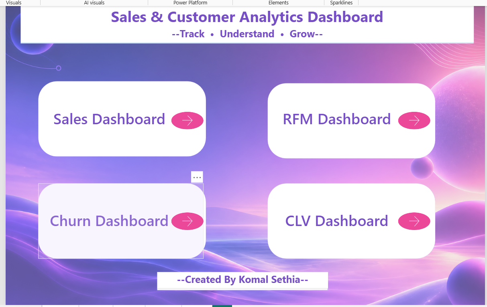
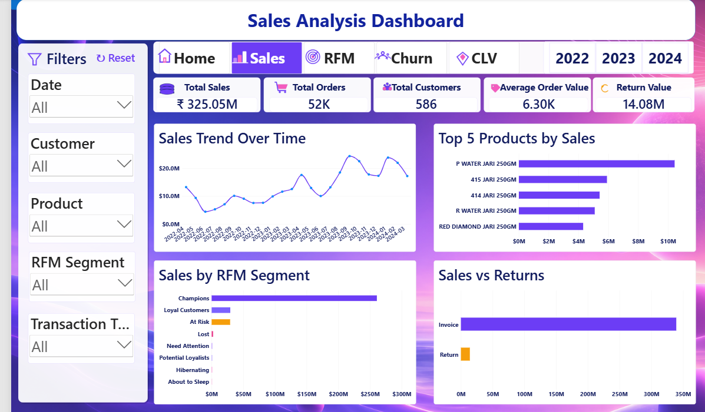
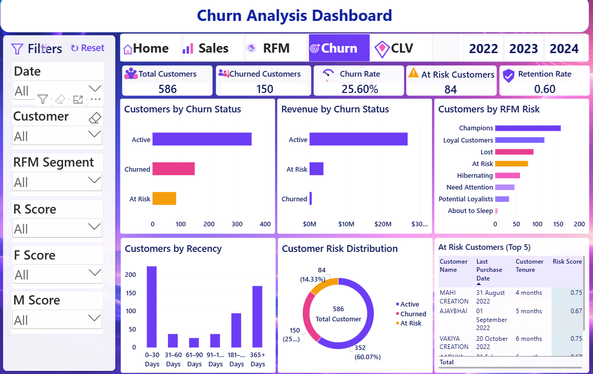
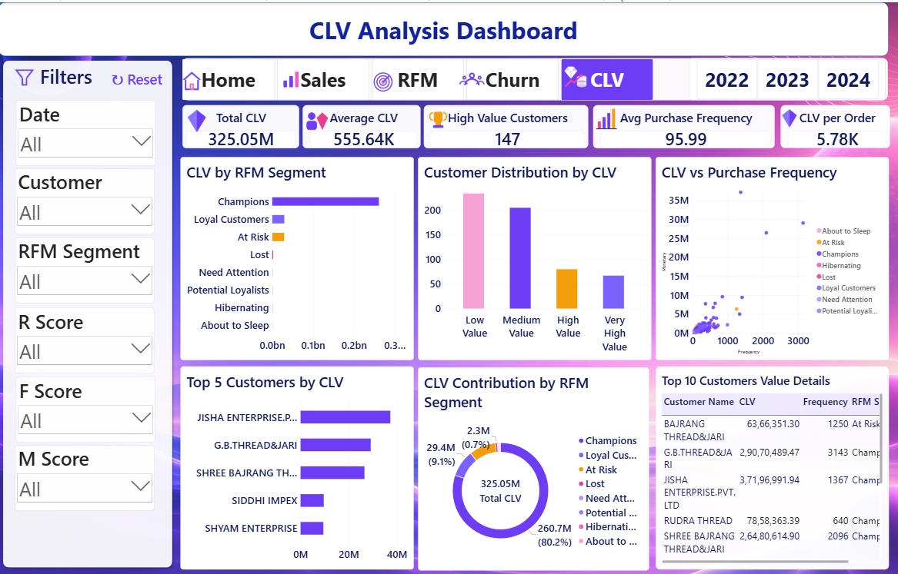
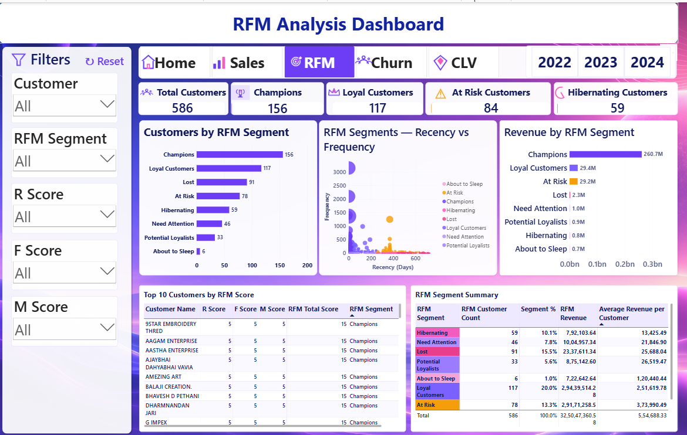

# Sales Data Cleaning & Customer Analytics — Pandas and Power BI

## Project Overview

This project demonstrates an end-to-end data analytics workflow, starting with raw Excel data, performing data cleaning and preparation using Python Pandas, and building interactive dashboards in Microsoft Power BI.

The objective is to transform raw sales data into a structured, analysis-ready dataset and generate meaningful business insights related to sales performance, customer churn, customer lifetime value, and customer segmentation.

## Tools & Technologies

- **Python** — Data processing and analysis
- **Pandas** — Data cleaning, transformation, and data preparation
- **NumPy** — Numerical operations
- **Jupyter Notebook** — Python coding and documentation
- **Microsoft Excel** — Raw and cleaned data files
- **CSV** — Exporting the cleaned dataset
- **Microsoft Power BI** — Interactive dashboards and visualizations

## Project Workflow

1. **Raw Data:** Started with the original Excel dataset containing sales and customer-related information.
2. **Data Cleaning:** Used Python Pandas in Jupyter Notebook to clean and prepare the data.
3. **Data Transformation:** Standardized column names, handled missing and duplicate records, corrected data types, and prepared the dataset for analysis where applicable.
4. **Dataset Export:** Exported the cleaned dataset to CSV format using Pandas.
5. **Power BI Integration:** Imported the cleaned dataset into Power BI to create interactive reports.
6. **Dashboard Development:** Developed separate dashboard views for sales performance, customer churn, customer lifetime value, and RFM analysis.

## Power BI Dashboards

### 1. Home Dashboard

The main landing page provides navigation to the different analytical dashboards.

### 2. Sales Analysis Dashboard

Analyzes sales performance and presents sales-related trends and business metrics.

### 3. Customer Churn Dashboard

Focuses on customer churn analysis to help understand customer retention and identify potential areas of concern.

### 4. Customer Lifetime Value (CLV) Dashboard

Presents customer lifetime value analysis to support customer value assessment and business decision-making.

### 5. RFM Analysis Dashboard

Uses Recency, Frequency, and Monetary analysis to segment customers based on their purchasing behaviour and value.

## Repository Structure

- `Pandas_Master_Project.ipynb` — Jupyter Notebook containing the Pandas data cleaning workflow.
- `final_dashboard_project.pbix` — Power BI report containing the dashboard pages.
- `Master_Sales_PowerBI_Final_Cleaned.xlsx` — Cleaned Excel dataset, if suitable for public sharing.
- `Home.png` — Home dashboard preview.
- `Sales_Dashboard.png` — Sales dashboard preview.
- `Churn_Dashboard.png` — Customer churn dashboard preview.
- `CLV_Dashboard.png` — Customer lifetime value dashboard preview.
- `RFM_Dashboard.png` — RFM analysis dashboard preview.

## Key Learnings

- Cleaning and transforming raw datasets using Python Pandas.
- Handling data quality issues before analysis.
- Exporting analysis-ready data from Python to CSV.
- Integrating cleaned datasets with Power BI.
- Designing interactive dashboards for sales and customer analytics.
- Applying customer segmentation and business analysis concepts.

## Project Objective

To demonstrate practical skills in Python-based data cleaning, data preparation, and Power BI dashboard development through an end-to-end analytics project.

## Note

The Power BI report can be opened using Microsoft Power BI Desktop. The Jupyter Notebook can be viewed on GitHub or executed in a compatible Python environment after configuring the required dataset paths.

**Technologies:** Python | Pandas | NumPy | Jupyter Notebook | Excel | CSV | Power BI
